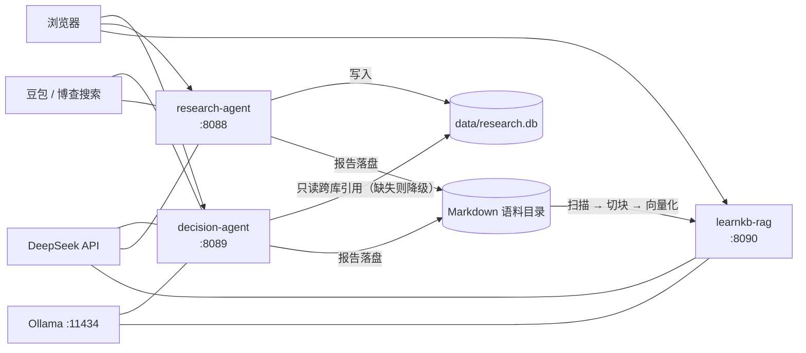

# kf-agent

三个可独立运行、又能互相引用的本地 AI Agent，覆盖**决策分析**、**深度调研**与**知识库问答**：调研 Agent 回答"世界是什么样"，决策 Agent 回答"你是谁、这条路走不走得通"，知识库把两者的产出沉淀为可检索的语料。


## 子项目一览

| 项目 | 端口 | 解决什么问题 | 核心机制 | 外部依赖 |
|---|---|---|---|---|
| [decision-agent](decision-agent/) | 8089 | "我想做这件事、通过这种方式，可行吗"——结合个人画像与历史执行力给出结构化可行性判断 | 六步分析流程 + 三档情景 A/B/C + 红队质疑‑修订‑复审收敛 | DeepSeek、豆包/博查搜索；只读引用 research.db |
| [research-agent](research-agent/) | 8088 | 给定调研主题，自主完成多轮检索并产出带引用的调研报告 | 弹性调研循环（模型自主判停）+ 审稿修订闭环 + SSE 实时画布 | DeepSeek、豆包/博查搜索 |
| [learnkb-rag](learnkb-rag/) | 8090 | 把本地 md/txt 笔记变成可自然语言提问的知识库，回答附来源 | 扫描切块 → 向量化 → 检索召回 → 拼提示词生成 | 本地 Ollama（Embedding） |

三个项目均为 Java 21 + Spring Boot 3.3.5 + LangChain4j，存储统一用 SQLite（JdbcTemplate 直连，无 ORM）。

---

## 1. decision-agent（决策 Agent，8089）

**定位**：个人决策参谋。与通用聊天模型的差异不在"更会说"，而在"它知道你"——个人上下文库 + 历史行为数据，让同样的问题得到为你定制的分析。

**工作流程**（六步，可按深度路由升降级）：

1. **意图识别**：判断问题类型（学习计划 / 日常事务 / 远期规划 / 商业经营）并选择路径；
2. **交互采集**：多轮追问补齐时间、资源、历史执行力等槽位，敏感数据在槽位结构化时脱敏；
3. **可行性评估**：按问题类型取分桶校准系数（冷启动用全局 0.7 并显式标注）修正预期；
4. **路径设计**：输出乐观 / 现实 / 保守三档情景，各含里程碑、验收标准与降档触发条件；
5. **差距分析**：对比现状与目标，给出能力缺口与 kill criteria；
6. **风险与对策**：先跑代码确定性校验（三档单调性、现实档是否按系数修正、周期一致性），再交模型红队，经"质疑 → 修订 → 复审"循环，直到无严重质疑或预算/轮次耗尽。

外部世界信息按三段递进获取：先查 research-agent 已有报告（零成本引用）→ 不足才联网搜索 1~3 条 → 仍不足则提示发起完整调研。成本护栏：单次分析模型调用 ≤ 8 次（deep 路径 12 次）、时长 ≤ 3 分钟。

**启动**：

```bat
cd decision-agent
start.bat                  :: 等价于 mvn -s settings.xml spring-boot:run
```

访问 http://localhost:8089 。

**关键配置**（`decision-agent/src/main/resources/application.yml`）：

- `server.port` 默认 8089；
- `agent.llm.provider`（deepseek / openai-compatible / ollama）、`agent.llm.deepseek.api-key` 取 `${DEEPSEEK_API_KEY:}`；
- `agent.search.provider`（doubao / bocha）；
- `agent.budget.maxModelCalls`、`agent.budget.deepMaxModelCalls`、`agent.budget.maxDurationMinutes`、`agent.budget.maxSearchesPerAnalysis`；
- `agent.data.db-path` 默认 `data/decision.db`；
- `agent.data.research-db-path` 指向调研报告库（只读，文件不存在时降级）；
- `agent.data.research-markdown-dir` 为 research.db 不可用时的 Markdown 兜底扫描目录；
- `agent.report.output-dir` 报告落盘目录，写入失败自动降级到 `data/reports`。

---

## 2. research-agent（调研 Agent，8088）

**定位**：数据供应商。提交一个主题，它自主决定搜索策略与轮次，综合多源资料产出带引用编号的结构化报告，全过程实时可视化。

**工作流程**：

1. **策略规划**：模型产出本轮搜索计划（关键词与平台定向），可走 web / 知乎 / B 站 / 小红书；
2. **多轮检索**：豆包为主、博查为备；结果经 RankScore 过滤、去重与标题聚类后入库；
3. **自主判停**：每轮输出 `enough` 字段决定是否继续；护栏仅在失控时兜底（8 轮 / 30 次搜索 / 20 分钟 / 边际收益不足）；
4. **审稿修订**：区分 A 类写作缺陷与 B 类原料缺口，B 类触发补搜，修订后复审；
5. **报告产出**：流式生成 Markdown 报告并落盘语料目录，同时写入 SQLite 供页面回看。

**启动**：

```bat
cd research-agent
start.bat                  :: 等价于 mvn spring-boot:run
```

访问 http://localhost:8088 ，提交主题后进入 SSE 实时监控页（轮次泳道、节点状态、思考过程、审稿意见）。

**关键配置**（`research-agent/src/main/resources/application.yml`）：

- `server.port` 默认 8088；
- `agent.llm.provider`、`agent.llm.deepseek.api-key`（`${DEEPSEEK_API_KEY:}`）；
- `agent.search.provider`、`agent.search.doubao.api-key`（`${SEARCH_API_KEY:}`）、`agent.search.bocha.api-key`（`${BOCHA_API_KEY:}`）；
- `agent.budget.maxRounds` / `maxSearchesPerRound` / `maxTotalSearches` / `timeoutMinutes`；
- `agent.report.output-dir` 报告落盘目录，失败降级到 `data/reports/`。

数据落在 `research-agent/data/research.db`（任务、事件、报告、审稿问题，重启不丢）。

---

## 3. learnkb-rag（知识库问答，8090）

**定位**：知识沉淀层。递归扫描语料目录下的 `.md` / `.txt`，建向量索引后用自然语言提问，回答附带来源文件。

**工作流程**：

1. **扫描**：递归读取 `learnkb.corpus-dir` 下的 md/txt；
2. **切块**：按 `chunk-size` 切分并保留 `chunk-overlap` 重叠；
3. **向量化**：Embedding 默认走本地 Ollama（默认 `http://127.0.0.1:11434`）；
4. **入库持久化**：写入 `data/kb-store.json`，启动时自动载入；
5. **召回生成**：取 `top-k` 命中片段拼提示词，生成回答并回传来源片段。

接口：`POST /api/ingest`（重建索引）、`POST /api/chat`、`POST /api/search`（只检索不生成）、`GET /api/status`。

**启动**：

```bat
cd learnkb-rag
start.bat                  :: 检查/拉起 Ollama 后运行 target\learnkb-rag-1.0.0.jar
```

首次需先打包：`mvn -s settings.xml package`。访问 http://localhost:8090 ，笔记更新后在页面点「建立/重建索引」。

**关键配置**（`learnkb-rag/src/main/resources/application.yml`）：

- `server.port` 默认 8090；
- `learnkb.corpus-dir` 语料目录、`learnkb.store-file` 向量库文件（默认 `data/kb-store.json`）；
- `learnkb.chunk-size` / `learnkb.chunk-overlap` / `learnkb.top-k`；
- `learnkb.embedding.provider`（ollama / openai-compatible）与 `learnkb.embedding.ollama.base-url`；
- `learnkb.chat.provider`（ollama / deepseek / openai-compatible）：默认 `deepseek`，改 `ollama` 即可全离线。

---

## 快速开始

### 1. 环境要求

- **JDK 21**（系统默认 JDK 8 会导致编译失败，`start.bat` 内已设置 `JAVA_HOME`，按本机路径调整）
- **Maven 3.9+**
- **Ollama**（可选；仅 learnkb-rag 的 Embedding 需要，`start.bat` 会自动检测并拉起）

### 2. 配置环境变量（新开窗口生效）

```bat
setx DEEPSEEK_API_KEY "your-key"    :: 三个项目的 LLM，主
setx SEARCH_API_KEY "your-key"      :: 豆包搜索（主）
setx BOCHA_API_KEY "your-key"       :: 博查搜索（备）
```

切换到其它提供方时可选：`ARK_API_KEY`（豆包方舟 OpenAI 兼容）、`SILICONFLOW_API_KEY`（learnkb 云端 Embedding）。

### 3. 启动

三个服务端口互不冲突，可同时运行：

```bat
cd decision-agent && start.bat
cd research-agent && start.bat
cd learnkb-rag    && start.bat
```

| 服务 | 地址 |
|---|---|
| 决策 Agent | http://localhost:8089 |
| 调研 Agent | http://localhost:8088 |
| 知识库问答 | http://localhost:8090 |

## 项目关系



- **decision-agent → research-agent**：只读取 `research-agent/data/research.db` 做零成本报告引用；库不存在或无 report 表时降级为扫描 Markdown 报告目录，再不行才联网。
- **learnkb-rag**：完全独立运行，不调用其它两个服务；两个 Agent 的报告落盘到语料目录后，重建索引即可被检索到。
- **共享资源**：搜索额度为账号级共享（同一池子），测试时注意消耗。

## 目录结构

```
kf-agent/
├── decision-agent/              # 决策参谋，:8089
│   ├── src/main/java/com/decision/   # loop 六步编排+红队、collector 采集、external 报告引用、export 导出
│   ├── src/main/resources/      # application.yml、Thymeleaf 模板与静态资源
│   ├── settings.xml             # Maven 镜像与本地仓库配置
│   ├── start.bat
│   └── README.md
├── research-agent/              # 调研 Agent，:8088
│   ├── src/main/java/com/research/   # ResearchLoop 弹性循环、ReviewService 审稿修订
│   ├── src/main/resources/
│   ├── start.bat
│   └── README.md
├── learnkb-rag/                 # RAG 知识库，:8090
│   ├── src/main/java/com/learnkb/    # config 模型装配、service 切块/检索、controller REST
│   ├── settings.xml
│   ├── start.bat
│   └── README.md
└── .gitignore
```

## 配置与密钥

- 所有 API Key 通过**环境变量**注入，代码与配置中只出现 `${DEEPSEEK_API_KEY:}` 这类占位符，无硬编码密钥。
- `data/`（SQLite 库、报告、向量库）、`recordings/`、`*.log`、`.env`、`application-local.yml` 已在 `.gitignore` 中排除，请勿提交；尤其不要把 `research-agent/data/research.db` 等 `*.db` 提交（可能含个人调研内容）。
- 报告落盘目录与语料目录默认指向本机笔记路径，克隆后请按需修改 `agent.report.output-dir`、`agent.data.research-markdown-dir`、`learnkb.corpus-dir`。
- 修改 `application.yml` 必须重启服务生效（Spring Boot 不热加载）；前端静态资源改动需同步到 `target/classes`。

## 许可证

本仓库及三个子项目均**暂未声明许可证**。如需对外复用，请先补充 LICENSE 文件。
