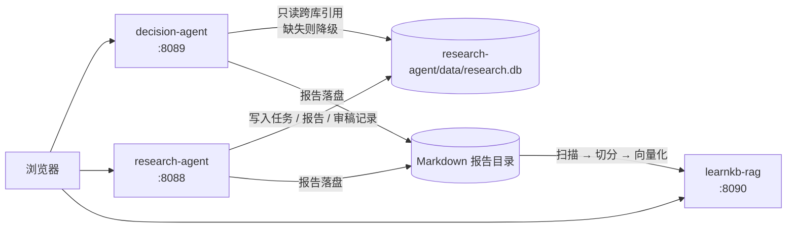

<div align="center">

# kf-agent

**三个可独立运行的本地 Java Agent，分别负责决策可行性分析、联网深度调研与本地知识库问答。**

[](https://www.oracle.com/java/)
[](https://spring.io/projects/spring-boot)
[](https://docs.langchain4j.dev/)
[](#许可证)

</div>

## 三个项目对比

| 项目 | 解决什么问题 | 核心机制 | 端口 |
|---|---|---|---|
| [decision-agent](decision-agent/) | "我想做这件事，通过这种方式，可行吗" | 六步可行性循环 + 红蓝对抗 + 预算护栏 + record/replay | 8089 |
| [research-agent](research-agent/) | 给定主题，自主检索并产出带引用的调研报告 | 多轮检索 + 交叉验证与审稿修订 + SSE 实时推送 | 8088 |
| [learnkb-rag](learnkb-rag/) | 把本地 md/txt 笔记变成可提问的知识库 | 切分 → embedding → 向量检索 → 生成 | 8090 |

三者均为 Java 21 + Spring Boot 3.3.5 + LangChain4j，数据用 SQLite 落盘，前端为服务端模板页面 + 原生 JS。决策 Agent 与调研 Agent 之间只有一条**单向只读**的数据引用，其余互不依赖。

---

## 1. decision-agent（决策参谋，:8089）

**定位**：个人决策可行性分析 Agent。不追求"更会说"，而是结合个人画像与历史执行数据，对"这件事我能不能做成"给出结构化判断。

**关键设计**

- **五阶段流程**：需求收集（多轮追问补齐时间、预算、历史执行力等槽位）→ 意图识别 → 可行性分析循环 → 红蓝对抗校验（红队质疑、修订、复审）→ 报告导出。
- **预算护栏**：单次分析限制模型调用次数与总时长，超限即收敛并标注降级原因，避免一次请求无限烧额度。
- **record / replay**：录制真实分析过程，离线回放做回归测试，调 Prompt 或流程后可比对输出差异。
- **只读跨库引用**：读取 `research-agent/data/research.db` 中已有的调研报告作为事实来源；库不存在时降级为扫描 Markdown 报告目录，再不行才走联网检索。
- **报告导出**：支持 HTML / Markdown 等格式落盘，写入失败时降级到 `data/reports`。

**启动**：

```bat
cd decision-agent
start.bat
```

访问 http://localhost:8089 。详细配置项见 [decision-agent/README.md](decision-agent/README.md)。

---

## 2. research-agent（调研 Agent，:8088）

**定位**：研究与数据供应方。提交一个主题，它自主决定检索策略与轮次，产出带引用编号的结构化报告，过程实时可见。

**关键设计**

- **多轮检索**：检索源支持 Doubao 与 Bocha（一主一备），每轮由模型规划关键词，结果经过滤、去重与聚类后入库。
- **交叉验证与审稿**：区分写作缺陷与原料缺口，缺口触发补充检索，修订后复审，降低单源失真的影响。
- **SSE 实时推送**：轮次、节点状态、思考过程、审稿意见通过 Server-Sent Events 推到前端，无需轮询。
- **任务与报告落库**：任务、事件、报告、审稿问题写入 `data/research.db`，重启不丢，可供其它 Agent 只读引用。
- **弹性判停**：由模型判断信息是否足够，护栏仅在失控时兜底（轮次、搜索次数、时长上限）。

**启动**：

```bat
cd research-agent
start.bat
```

访问 http://localhost:8088 。详细配置项见 [research-agent/README.md](research-agent/README.md)。

---

## 3. learnkb-rag（本地知识库，:8090）

**定位**：知识沉淀层。扫描本地笔记目录，建立向量索引后用自然语言提问，回答附带来源片段。

**关键设计**

- **全链路本地化**：切分与 embedding 使用 Ollama 本地模型，不外传笔记内容。
- **固定窗口切分**：按 `chunk-size` 切块并保留重叠，减少语义截断。
- **向量持久化**：索引存入 `data/kb-store.json`，启动时自动载入。
- **页面重建索引**：笔记更新后在页面上点一下即可重建，无需重启服务。
- **检索与生成解耦**：除问答外提供纯检索接口，便于核对召回质量。

**启动**：

```bat
cd learnkb-rag
start.bat
```

首次需先 `mvn -s settings.xml package`，脚本会在检查/拉起 Ollama 后运行 jar。访问 http://localhost:8090 。详细配置项见 [learnkb-rag/README.md](learnkb-rag/README.md)。

---

## 项目关系



- **decision-agent → research-agent**：单向只读。决策 Agent 只查 `research.db`，从不写入；文件不存在或无报告表时降级扫描 Markdown，两者都不可用才联网。
- **learnkb-rag**：不调用其它两个服务。把两个 Agent 的报告目录作为语料，重建索引后即可检索。

## 环境要求

| 依赖 | 要求 | 说明 |
|---|---|---|
| JDK | 21 | 低于 21 无法编译，`start.bat` 内可指定 `JAVA_HOME` |
| Maven | 3.9+ | 各子项目附带 `settings.xml`，可按需改镜像与本地仓库 |
| Ollama | 可选 | 仅 learnkb-rag 的 embedding 需要，默认 `http://127.0.0.1:11434` |
| LLM / 搜索 API Key | 按需 | 通过环境变量注入，配置文件中只保留 `${...}` 占位符 |

## 目录结构

```
kf-agent/
├── decision-agent/          # 决策参谋，:8089
│   ├── src/main/java/com/decision/
│   ├── src/main/resources/   # application.yml、页面模板
│   ├── start.bat
│   └── README.md
├── research-agent/          # 调研 Agent，:8088
│   ├── src/main/java/com/research/
│   ├── src/main/resources/
│   ├── start.bat
│   └── README.md
├── learnkb-rag/             # 本地知识库，:8090
│   ├── src/main/java/com/learnkb/
│   ├── src/main/resources/
│   ├── start.bat
│   └── README.md
└── .gitignore
```

## 运行数据与构建产物

- 各子项目的 `data/`（SQLite 库、报告、向量索引）属于运行时数据，已在 `.gitignore` 中排除，克隆后首次运行会自动生成。其中可能含个人内容，**不要提交**。
- `target/` 为 Maven 构建产物，同样已排除。
- API Key 全部走环境变量；`*.log`、`.env`、`application-local.yml` 一类本地覆盖配置不入库。

## 许可证

本仓库及三个子项目采用 **MIT License** 授权（仓库内未附带 `LICENSE` 文件，以此声明为准）。
